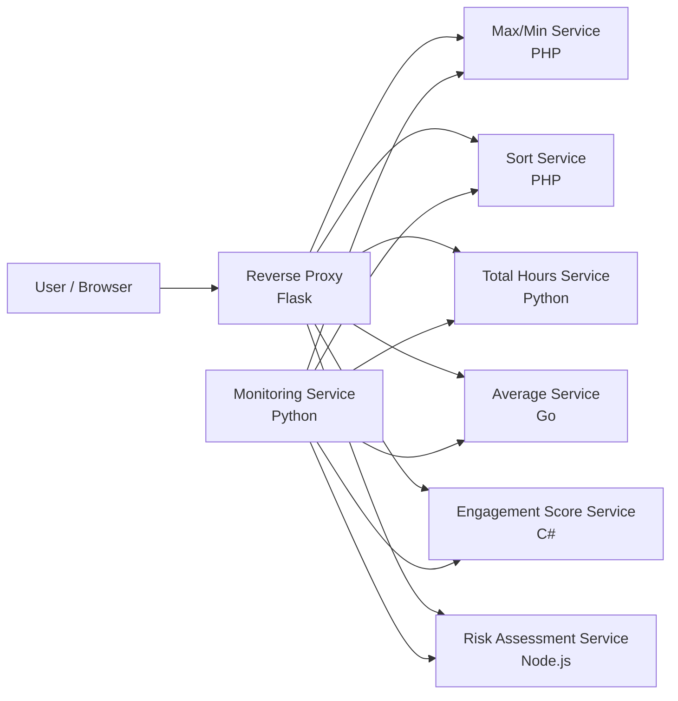

# QUB Engagement and Risk Monitoring Platform

## Overview
This project is a cloud-based microservice application designed to evaluate student engagement across several activity types, including lectures, labs, support sessions, and Canvas activity. The application calculates attendance summaries, identifies maximum and minimum sessions, ranks activity by participation, produces a weighted engagement score, classifies risk, and exposes a monitoring layer that checks each service for availability and correctness.

The implementation is intentionally split into multiple independent services written in different technologies so it can be run as a distributed container-based system.

## Architecture



## Main Components

### 1. Reverse proxy
- Location: `40295919/reverseproxy/`
- Technology: Python / Flask
- Purpose: routes requests from a single entry point to the correct backend service using port-based configuration.
- Default port: `5000`

### 2. Max/min service
- Location: `40295919/qubengage-maxmin/`
- Technology: PHP
- Purpose: calculates the highest and lowest attendance values and returns the relevant item labels.

### 3. Sort service
- Location: `40295919/qubengage-sort/`
- Technology: PHP
- Purpose: sorts attendance items in descending order and returns a ranked list.

### 4. Total hours service
- Location: `40295919/qubtotal_hours/`
- Technology: Python / Flask
- Purpose: sums attendance values for the four activity categories.

### 5. Average service
- Location: `40295919/qub-average/`
- Technology: Go
- Purpose: calculates the average attendance across lecture, lab, support, and canvas activities.

### 6. Engagement score service
- Location: `40295919/qub-engagementscore/`
- Technology: ASP.NET Core
- Purpose: calculates a weighted engagement score using category totals and weights.

### 7. Risk assessment service
- Location: `40295919/qubengagement-failure/`
- Technology: Node.js / Express
- Purpose: classifies engagement as Low, Moderate, or High based on score and cutoff value.

### 8. Monitoring service
- Location: `40295919/qub-monitor/`
- Technology: Python / Flask + APScheduler
- Purpose: runs automated checks against the services, logs results, and validates expected outputs.
- Default port: `5500`

## Port Mapping
The deployment model used by the project maps the core services to the following ports:

| Service | Port | Notes |
| --- | ---: | --- |
| Max/Min | 81 | Returns max/min values |
| Sort | 82 | Returns sorted attendance |
| Total Hours | 83 | Returns combined total |
| Engagement Score | 84 | Computes weighted engagement score |
| Average | 86 | Calculates average attendance |
| Risk Assessment | 89 | Returns risk classification |
| Reverse Proxy | 5000 | Routes incoming requests |
| Monitoring App | 5500 | Runs service health checks |

## Project Structure

```text
A2/
├── A2.sln
├── README.md
├── 40295919/
│   ├── qub-average/
│   │   ├── src/
│   │   ├── Dockerfile
│   │   ├── README.md
│   │   └── go.mod
│   ├── qub-engagementscore/
│   │   ├── src/
│   │   ├── Tests/
│   │   ├── Dockerfile
│   │   └── README.md
│   ├── qub-monitor/
│   │   ├── docker-compose.yml
│   │   ├── monitor.py
│   │   ├── monitorTest.py
│   │   ├── README.md
│   │   └── requirements.txt
│   ├── qubengage-failure/
│   │   ├── totalRiskApp.js
│   │   ├── Dockerfile
│   │   ├── README.md
│   │   └── test.js
│   ├── qubengage-frontend/
│   │   ├── src/
│   │   ├── Dockerfile
│   │   └── README.md
│   ├── qubengage-maxmin/
│   │   ├── src/
│   │   ├── Dockerfile
│   │   ├── README.md
│   │   └── composer.json
│   ├── qubengage-sort/
│   │   ├── src/
│   │   ├── Dockerfile
│   │   ├── README.md
│   │   └── composer.json
│   ├── qubtotal_hours/
│   │   ├── src/
│   │   ├── Dockerfile
│   │   ├── README.md
│   │   └── requirements.txt
│   ├── reverseproxy/
│   │   ├── reverseproxy.py
│   │   ├── proxy_config.json
│   │   ├── Dockerfile
│   │   ├── README.md
│   │   └── requirements.txt
│   └── README.md (if present in some copies)
├── qub-monitor rename/
├── qub-monitor - copy/
├── qubproxy/
├── git/
└── other assignment artifacts and duplicate folders
```

## How the Application Works
1. A user submits engagement values or activity data through the UI or direct API calls.
2. The reverse proxy receives the request and forwards it to the relevant backend service.
3. Each service performs a calculation or classification.
4. The monitoring service periodically invokes the endpoints with known test inputs and logs response performance and correctness.
5. Results can be reviewed through the service responses or the monitor log file.

## Example Service Behaviour

### Average attendance
Endpoint: `/average`  
Parameters: `lecture`, `lab`, `support`, `canvas`  
Returns:

```json
{
  "average": 20
}
```

### Engagement score
Endpoint: `/EngagementScore`  
Parameters: `lec`, `lab`, `supp`, `can`, plus category totals (`lecTotal`, `labTotal`, `suppTotal`, `canTotal`)  
Returns a weighted score between `0` and `1`.

### Risk assessment
Endpoint: `/RiskAssessment`  
Parameters: `engagementScore`, `cutoff`  
Returns one of:
- `Low`
- `Moderate`
- `High`

## Running the Project

### Prerequisites
- Docker
- Docker Compose
- Python 3 (for the monitoring and proxy services)
- Node.js (for the risk assessment service if run standalone)
- Go (for the average service if run standalone)
- .NET SDK (for the engagement score service if run standalone)

### Option 1: Run the orchestration stack
From the service orchestration directory:

```bash
cd 40295919/qub-monitor
docker compose up --build
```

This starts the monitoring service and the backend services exposed on the mapped ports.

### Option 2: Run the reverse proxy separately

```bash
cd 40295919/reverseproxy
docker build -t reverseproxy .
docker run -p 5000:5000 reverseproxy
```

The proxy acts as a central entry point and forwards requests based on target port values.

### Option 3: Run individual services
Each service directory contains its own Dockerfile and source code, so it can also be built and run independently if required.

## Monitoring and Validation
The monitoring app is implemented in `40295919/qub-monitor/monitor.py` and checks service responses against expected values, then records results to the log file:

```text
40295919/qub-monitor/service_monitoring_log.txt
```

The monitor also captures response times for each service and records the status of pass/fail checks.

## Typical Development Workflow
1. Build and start the services with Docker Compose.
2. Ensure the reverse proxy is running on port `5000`.
3. Send requests through the proxy or directly to the service port.
4. Check the monitoring endpoint at `http://localhost:5500/monitor`.
5. Review outputs in the generated monitoring log.

## Notes
- This repository contains a few duplicate and historical folders (`qub-monitor - copy`, `qub-monitor rename`, `git/`, archival copies), which appear to be older or backup versions of the same project.
- The active application structure is centred around the `40295919` folder and the service orchestration in `qub-monitor`.
- The project is designed as a teaching-style cloud assignment and demonstrates how multiple services can be combined into a cohesive distributed application.

## Summary
This project demonstrates a practical microservice architecture for a student engagement system, combining frontend-style interaction, API routing, computational services, and live monitoring in a single cloud application environment.
